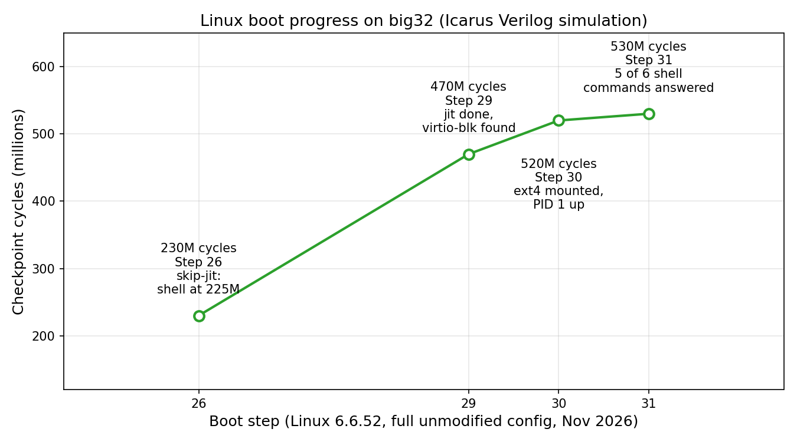
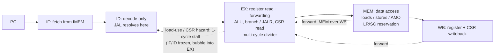

# big32

[](https://github.com/themythofsisyphusjayant/BIG-32)
[](https://github.com/themythofsisyphusjayant/BIG-32)
[](LINUX_BOOT.md)

A 32-bit RISC-V CPU built from scratch in Verilog: a pipelined RV32IMA core
with a single-cycle sibling, a Python behavioural model that runs the same
programs, a two-pass assembler, a small supervisor kernel — and, in
simulation, a Linux 6.6.52 boot to a working shell.

Status as of 9 November 2026. Simulation only, throughout: Icarus Verilog
12.0. Not silicon, not production-ready.

## At a glance

| Item | Detail |
|---|---|
| ISA | RV32IMA — base integer + M (mul/div) + A (atomics, word only); the device tree declares `rv32ima` |
| Cores | v7 single-cycle core (`src/big32_core.v`); 5-stage pipelined core (`src/big32_core_pipe.v`) with identical semantics |
| Pipeline | IF → ID → EX → MEM → WB; MEM-over-WB forwarding; 1-cycle load-use stall; CSR hazard stall |
| Privilege | M/S/U modes, trap delegation, `sret`/`mret`, vectored `mtvec` |
| MMU | Sv32, multi-cycle page-table walker, 16-entry TLB (Phase 5), A/D bit updates, `sfence.vma` |
| Bare-core memory | Harvard: 16 KB instruction memory (4096 words), 64 KB byte-addressable data memory (modulo 64 KB) |
| SoC memory | Unified RAM at 0x80000000 (parameterised; 32 MiB for the Linux boot) |
| Platform (Phase 5) | SBI firmware, device tree, PLIC, 16550 UART, 64-bit CLINT, virtio-mmio block device, bootloader |
| Verification | Directed suites + random differential testing (Python model vs Verilog), 50/50 per batch |
| Synthesis | Yosys 0.33 on the v7 single-cycle core: 42,731 cells, 1,291 flip-flops (see below) |

## Status

| Phase | What | State |
|---|---|---|
| 1 | 5-stage pipelined core, same semantics as the v7 single-cycle core | Done |
| 2–3 | M/S/U privilege, interrupts, Sv32 MMU, unified-memory SoC | Done |
| 4 | SBI-style M firmware, S-mode kernel, U-mode user program | Done |
| 5 | SoC2 platform: SBI firmware, device tree, PLIC, 16550 UART, 64-bit CLINT, virtio-blk, TLB, A/D bits | Done |
| 5 | Linux 6.6.52 boots to a working shell (skip-jent config) | Proven — Step 26 |
| 5 | Same boot, full unmodified kernel config | Proven — Steps 29–31 |

## Verified result: Linux boots to a shell

Linux 6.6.52 rv32 boots on this CPU in Icarus Verilog simulation, mounts a
root filesystem from a virtio block device, runs `/init` as PID 1, and drops
into a working shell. The full step-by-step record is in
[`LINUX_BOOT.md`](LINUX_BOOT.md).

### Boot results

| Step | Date | Cycles | What was proven |
|---|---|---|---|
| 26 | 6 Nov 2026 | 210M → 230M | Skip-jent config: shell driven at 225M; bare `cat` → `cat: missing file`, bare `echo` → newline, `echo hello` → `hello`, `cat /hello.txt` → file contents. Zero "cannot open directory", zero "Kernel panic", zero "Oops". 230M checkpoint banked. |
| 29 | 8–9 Nov 2026 | 250M → 470M | Full unmodified config: jitterentropy (`jent_mod_init`, 1,124 SHA3 rounds) finished after a soft-lockup warning, serial console `ttyS0` enabled, virtio-blk detected `[vda] 2048 512-byte blocks`. 22 segments, 11h 50m wall. |
| 30 | 9 Nov 2026 | 470M → 520M | Full config: ext4 root mounted readonly, `Run /init as init process`, PID 1 up, `big32#` prompt. 5 segments, 2h 38m wall. 520M checkpoint banked. |
| 31 | 9 Nov 2026 | 520M → 530M | Full config: 5 of 6 typed commands answered — `ls`, `cat /hello.txt`, `uname` (`Linux 6.6.52 riscv32`), `pwd` (`/`), `echo done`. `echo hello` lost its first two bytes at feed start (startup transient, mechanism unconfirmed; the same `echo` works later in the run). |



*Checkpoint cycles reached at each boot step (Linux 6.6.52, full unmodified
config, Nov 2026). Data: the boot-results table above — Step 26: 230M,
Step 29: 470M, Step 30: 520M, Step 31: 530M.*

Two configurations are proven:

- **Skip-jent config (Step 26, 6 Nov 2026).** The boot was resumed from a
  210M-cycle checkpoint and the shell was driven at 225M cycles. In order:
  bare `cat` → `cat: missing file`; bare `echo` → a bare newline;
  `echo hello` → `hello`; `cat /hello.txt` → `Hello from the big32 root
  filesystem.` Bare `ls`, `uname`, and `pwd` also work. Zero "cannot open
  directory", zero "Kernel panic", zero "Oops" in the log.
- **Full unmodified kernel config (Steps 29–31, 8–9 Nov 2026).** The stock
  kernel used to stall in `jent_mod_init` (jitterentropy initialisation,
  1,124 rounds of SHA3). Step 29 ground it 250M → 470M cycles: jent
  finished, the serial console was enabled, and virtio-blk found the disk
  (`[vda]`). Step 30 ground it 470M → 520M: VFS mounted root (ext4,
  readonly), `Run /init as init process`, PID 1 up, and the `big32#`
  prompt — with nothing blacklisted. Step 31 typed commands at that prompt
  and 5 of 6 answered: `ls`, `cat /hello.txt`, `uname`
  (`Linux 6.6.52 riscv32`), `pwd` (`/`), `echo done`. `echo hello` did not:
  the first two feed bytes were lost at feed start, a startup transient,
  mechanism unconfirmed (the same `echo` works later in the run). The 530M
  checkpoint is banked as the resume point.

### Why the boot is slow

Icarus simulates at roughly 36 minutes per 10M cycles at the grind's pace,
so the full-config boot (170M → 530M cycles) took days of wall time in
10M-cycle checkpointed segments. That is the simulator, not the CPU — a
faster simulator or an FPGA is on the roadmap. Checkpoints are banked every
10M cycles so a VM reboot costs only the partial segment, never the run.

## The core

The instruction set below is the v7 single-cycle core's. The pipelined core
in `src/big32_core_pipe.v` keeps its exact semantics — see
[`PIPELINE.md`](PIPELINE.md).

- 32 registers x0–x31 (x0 hardwired to 0), 32-bit program counter.
- Single-cycle: fetch, decode, execute, memory, writeback in one clock.
- RV32I base integer instructions, all formats: R, I, loads (lb, lh, lw,
  lbu, lhu), stores (sb, sh, sw, little-endian), branches, jal, jalr, lui,
  auipc, ecall, ebreak.
- RV32M (v2): mul, mulh, mulhsu, mulhu, div, divu, rem, remu — including
  the spec edge cases: div by zero returns -1, rem by zero returns the
  dividend, (-2147483648) / (-1) returns -2147483648.
- RV32A, word only (v3): lr.w, sc.w, amoadd.w, amoswap.w, amoxor.w, amoor.w,
  amoand.w, amomin.w, amomax.w, amominu.w, amomaxu.w, with an LR/SC
  reservation (single core, so each atomic is a read-modify-write in one
  cycle).
- M-mode CSRs (v3): mstatus, mtvec, mscratch, mepc, mcause, mtval, mhartid
  (read-only 0). Instructions: csrrw, csrrs, csrrc, csrrwi, csrrsi, csrrci,
  plus the pseudos csrw, csrs, csrc, csrr, and mret. ECALL/EBREAK trap to
  mtvec (mcause 11/3) when mtvec is non-zero, and halt when mtvec is zero —
  so plain test programs ending with ECALL still halt, while a kernel that
  sets mtvec gets control on every ECALL.
- UART MMIO (v3): store a byte to 0x10000000 to transmit it; loads from
  0x10000004 (RX) return -1 (no input in this core), loads from 0x10000008
  (status) return 0.
- Memory (Harvard, for now): 16KB instruction memory (4096 words) and 64KB
  byte-addressable data memory (addresses modulo 64KB).
- Assembler pseudos: nop, mv, li (small immediates as addi, larger ones as
  lui + addi), j, jr, ret, la (auipc + addi, pc-relative), and character
  literals in li, e.g. `li a0, 'A'`.

## The pipelined core (Phase 1)

`src/big32_core_pipe.v` is a 5-stage pipeline with the v7 core's exact
instruction semantics. Full design is in [`PIPELINE.md`](PIPELINE.md).

| Stage | Work |
|---|---|
| IF | `pc` drives the fetch address; instruction is combinational from IMEM |
| ID | Decode only (opcode, rd, rs1, rs2, funct3/7, immediates, CSR address, AMO funct5). Register operands are not read here. JAL resolves here. |
| EX | Register read + forwarding, ALU (incl. combinational MUL), branch/JALR resolution, CSR old-value read, multi-cycle divider. Traps, `mret`, halts resolve here. |
| MEM | Data access. Loads form `load_data`; stores/AMO drive write enables. AMO read-modify-write is atomic here (single core, one MEM cycle); LR/SC reservation checked and updated in program order. |
| WB | Register writeback and CSR write, at the end of the WB cycle. x0 writes discarded. |



- **Forwarding:** two muxes per EX operand, priority MEM over WB over the
  register file. For a load, the MEM forward value is the combinational
  `load_data`; for an AMO, the old word; for SC, 0/1 from the reservation
  check.
- **Stalls (IF/ID frozen, bubble into EX, MEM/WB keep draining):**
  load-use, 1 cycle — EX holds a load whose rd matches the ID
  instruction's rs1/rs2 (the match is deliberately broad; a spurious stall
  is safe, a missed stall is not). CSR hazard — a SYSTEM instruction in ID
  stalls while a CSR write is pending in EX or MEM (a WB CSR write needs
  no stall: it lands before the held instruction reaches EX).
- **Branches and JALR resolve in EX**, using the forwarding muxes, so a
  load feeding a branch costs the same 1-cycle stall as any load-use.

## Privilege, interrupts, MMU (Phases 2–3)

On top of the pipelined core: M-mode interrupts (CLINT timer, external
line, 16-byte UART RX FIFO), vectored `mtvec`, privilege modes M/S/U with
trap delegation and `sret`, and an Sv32 MMU with a multi-cycle page-table
walker (no TLB) on a unified-memory SoC top (`src/big32_soc.v`). Full
design, CSR/bit lists, walk timing, memory map, and deviations from the
privileged specification are in [`PRIVILEGE_MMU.md`](PRIVILEGE_MMU.md).
Re-run with `./run_soc.sh` (11/11 SoC checks, then the Phase 1 pipe suite
as regression).

## OS boot (Phase 4)

M-mode firmware delegates traps to an S-mode kernel, which enables Sv32
translation, counts CLINT timer ticks, drops to U-mode, serves print/exit
syscalls, demand-maps a faulting page, and shuts down cleanly through the
firmware — with the full UART boot transcript checked byte-for-byte. Full
design, delegation table, memory map, syscall ABI, transcript, and the
Linux roadmap are in [`OS_BOOT.md`](OS_BOOT.md). Re-run with `./run_os.sh`.

This phase also fixed a latent core bug: S interrupt delivery now requires
the source to actually be pending (previously, merely enabling an S
interrupt took a phantom interrupt forever).

xv6-riscv is not an intermediate step here: it is RV64/Sv39 and cannot run
on this RV32/Sv32 core. RV32 Linux, by contrast, is architecturally
possible — and Phase 5 proves it boots.

## Linux platform (Phase 5)

New SoC top `src/big32_soc2.v` (the Phase 2–4 top is untouched): SBI
firmware (Base, TIME, sPI, RFNC, SRST, legacy putchar) in
`os_programs/sbi_firmware.s`, a device tree in `os_programs/big32.dts`
(rv32ima, Sv32, PLIC, 16550 UART, CLINT, virtio-mmio), a real PLIC
(claim/complete, priorities, enables, lowest-ID tie-break), a
16550-compatible UART at 0x10010000, a 64-bit CLINT timer, a virtio-mmio
block device (queue 0, block only), and a bootloader that loads a kernel
image from virtio into RAM and drops to S-mode. Core gaps closed for Linux:
a real 16-entry TLB (sfence.vma flushes), A/D bit updates on page-table
walks (including D-miss re-walk), software interrupts (SBI IPI register at
0x10002000), TIME/CYCLE/INSTRET counters (the kernel clocksource reads
rdtime), and misaligned accesses now trap (causes 4/6) instead of silently
continuing into the next physical page. Tests: `./run_soc2.sh` (soc2 +
coregaps + sbi + dtb + boot + the full Phase 1–4 regression).

### SoC2 memory map

| Region | Address | Notes |
|---|---|---|
| ROM (2 instructions) | 0x00000000–0x00000FFF | `lui t0, 0x80000; jalr x0, 0(t0)` — the core resets pc to 0 and RAM lives at 0x80000000, which `jal` cannot reach, so the ROM is the only bridge |
| RAM | 0x80000000 + MEM_BYTES | Parameter, default 1 MiB; the Linux boot uses 32 MiB (`iverilog -Pbig32_soc2.MEM_BYTES=...`) |
| PLIC | 0x0C000000 | Standard layout: priorities, enables, claim/complete |
| CLINT | 0x02004000 mtimecmp, 0x0200BFF8 mtime | 64-bit each; mtime +1/cycle; timer pends while mtime >= mtimecmp |
| Legacy UART | 0x10000000 TX, 0x10000004 RX, 0x10000008 status | Core-driven; kept for the SBI console and old programs |
| virtio-mmio block | 0x10001000 | Device ID 2, version 2, queue 0 only |
| SBI IPI register | 0x10002000 | Any nonzero write sets the core's `irq_soft` line; zero clears it |
| 16550 UART | 0x10010000 | ns16550a-compatible; the Linux console (`ttyS0`, IRQ 2) |

One Icarus lesson from this platform, recorded in
[`LINUX_BOOT.md`](LINUX_BOOT.md): RAM is a word array with a single
synchronous virtio read port, not a byte array with ~44 combinational read
ports — `iverilog` on core + soc2 + testbench exits 0 in 0.062 s at the
1 MiB default, where the byte-array version hung past 164 s.

## The tiny OS kernel

`programs/kernel.s` is a supervisor, not a demo print. It boots, sets the
kernel stack (mscratch = 0x8000) and mtvec to its trap handler, and prints
`big32 OS` on the UART. It runs two apps in turn (sum 1..10, then 6 × 7)
via jal. Each app ends with ECALL. The trap handler swaps to the kernel
stack via mscratch, saves a0/a1/t0–t6/ra, prints `E=` plus the app's result
in decimal, advances mepc past the ECALL, restores everything, swaps the
stack back, and mrets — so the app returns normally to the kernel. It
prints `done`, clears mtvec, and ECALLs, which halts (mtvec == 0).

Expected UART output:

```
big32 OS
E=55
E=42
done
```

## Qasida on big32

Qasida (the language in
[RED-MOON-](https://github.com/themythofsisyphusjayant/RED-MOON-)) compiles
to big32. The demo in this repo is the generated program, not the compiler
itself — the compiler lives in the Qasida repo; what belongs here is the
program it produced and how to run it.

- `programs/forge_os.s` / `programs/forge_os.hex` — the Qasida OS demo,
  generated from a Qasida program that boots on big32, prints a banner,
  runs two apps (sum 1..10, then 6 × 7), prints their results, and halts
  via ECALL. It sits alongside, and does not replace, the assembly kernel
  `programs/kernel.s`.
- `tools/run_forge.py` — run any Qasida-generated `.hex` in both the Python
  model and Icarus Verilog, and print both UART transcripts for comparison:
  `python3 tools/run_forge.py programs/forge_os.hex`

Expected UART output (identical in model and Verilog):

```
forge OS on big32
boot ok
app_sum = 55
app_mul = 42
done
```

Honest limits: simulation only, subset language (int/bool/str/arrays,
loops, functions — no float, structs, threads, file I/O, network, or GC on
big32), native RISC-V arithmetic (wrapping, div by zero → -1), and the demo
runs on the bare core, not under Linux.

## Verification

Every claim above is checked by a test in this repo, not by inspection:

- **Directed suite:** 15 programs (`./run.sh`) — sum = 55, fib = 55,
  mul_loop = 42, call_demo = 112 with sp restored, all six M cases,
  amo_demo = 42, sc_fail = 101, csr_demo = 4660, and the kernel's UART
  output above, halting with sp restored to 65532. Verified 26 Oct 2026 in
  both the Python model and Icarus Verilog simulation.
- **Random differential testing:** `python3 tools/rand_test.py 50 0`
  generates 50 random, terminating programs (ALU, M, shifts, loads/stores
  to a scratch word, forward-only branches), runs each through the Python
  model and the Verilog simulation, and compares all 32 registers. 50/50
  pass. This is the small version of the riscv-torture / riscv-dv approach
  used by production cores, and it caught three real bugs the 14 directed
  tests missed: SRAI was a logical shift in Icarus (`srai -56, 17` gave
  32767 instead of -1); signed DIV/REM were unsigned in Icarus for the
  same ternary-expression reason; both fixed with if/else and documented
  in the source.
- **Pipelined core:** `./run_pipe.sh` — 16/16 directed checks with full
  register/UART/memory comparison, 50/50 hazard-heavy random tests, plus a
  second 50/50 batch on fresh seeds.
- **SoC2 platform checks** (recorded in [`LINUX_BOOT.md`](LINUX_BOOT.md)):
  PLIC PASS (32,089 cycles), software IPI PASS (258 cycles), SBI PASS
  (32,623 cycles, UART `S`), bootloader PASS (1,573 cycles, UART `BK`).
  Cycle counts vary a few cycles run to run.

What this does not have: no RISCOF compliance, no formal verification, no
CI, no silicon. Those are the next production steps, not claims made here.

## Synthesis (v7) — core logic only, memories excluded

Yosys 0.33, 26 Oct 2026, run took 225 seconds, exit code 0 (the log itself
is not in this repo; the numbers below are the run's recorded result):

```sh
yosys -Q -T -l /tmp/yosys_v7.log -p 'read_verilog src/big32_core.v; hierarchy -top big32_core; proc; opt; fsm; opt; memory; opt; techmap; opt; stat'
```

```
=== big32_core ===

   Number of wires:               9551
   Number of wire bits:          75081
   Number of memories:               0
   Number of memory bits:            0
   Number of cells:              42731
     $_AND_                      17334
     $_DFFE_PN0P_                 1289
     $_MUX_                       4373
     $_NOT_                       1328
     $_OR_                       10560
     $_XOR_                       7845
```

Read honestly, not as a gate count:

- **Memories: 0, memory bits: 0** — the v7 core/memory split worked. Yosys
  no longer turns memory into registers, which was the whole point of v7.
- **Flip-flops: 1291**, which is exactly the architectural state: PC 32 +
  registers 32×32 = 1024 + six CSRs 6×32 = 192 + reservation_valid 1 +
  reservation_addr 32 + halted 1 + uart_tx 8 + uart_tx_valid 1 = 1291.
  That match is a good cross-check that Yosys saw the intended core.
- **Combinational cells: 41440.** That is large, and the reason is the
  single-cycle design: a 32-bit divider/modulo unit and 64-bit multipliers,
  all combinational, in one cycle. It is not a kGE figure (no technology
  library was mapped, and no ABC gate optimisation to standard cells was
  run), so do not quote it as one — and do not compare it directly with
  Ibex's 15–30kGE, which is a pipelined core with multi-cycle multiplier
  options. If area matters, the next step is a multi-cycle divider /
  multiplier (or a pipeline), not a bigger single-cycle ALU.
- Memories are reported separately as SRAM bits, not logic: IMEM 4096×32 =
  131072 bits, DMEM 65536×8 = 524288 bits.

The v7 numbers above are the single-cycle core only. Synthesis numbers for
the pipelined core are still open.

## Layout

| Path | Contents |
|---|---|
| `src/` | Verilog: single-cycle core, pipelined core, SoC tops (Phases 2–5) |
| `tools/` | Assembler, Python model, random testers, per-phase checkers, kernel/SBI/image builders, checkpoint boot runners |
| `sim/` | Testbenches, including the checkpoint boot testbenches |
| `programs/` | Directed test programs (`.s` with assembled `.hex`), the kernel, the Qasida demo, `rand_*` differential-test programs |
| `os_programs/` | SBI firmware, device tree, bootloader, S-mode kernel, user program |
| `soc_programs/`, `soc2_programs/` | Phase 2–3 and Phase 5 SoC test programs |
| `soc2_hex/` | Phase 5 hex images: SBI firmware, device trees, root-filesystem disk image |
| `rootfs/` | Root filesystem: `init.asm` (the shell), `mkelf.py`, `rootfs.img` (1 MiB ext4), `hello.txt`, RX feed files |
| `LINUX_BOOT.md` | Full Linux boot record, Steps 1–31 |
| `OS_BOOT.md`, `PIPELINE.md`, `PRIVILEGE_MMU.md` | Phase 4, Phase 1, and Phases 2–3 design docs |

## Run it

Prerequisites: Python 3 and Icarus Verilog 12.0 (`iverilog`, `vvp`).

```sh
./run.sh        # assembles, runs the Python model, compiles + simulates the Verilog
python3 tools/rand_test.py 50 0   # random differential tests, model vs Verilog
```

Per phase:

```sh
./run_pipe.sh   # Phase 1: pipelined core, directed + random
./run_soc.sh    # Phases 2–3: SoC checks + Phase 1 regression
./run_os.sh     # Phase 4: OS boot transcript + full regression
./run_soc2.sh   # Phase 5: SoC2 platform + full Phase 1–4 regression
```

Run one program by hand:

```sh
python3 tools/asm.py programs/sum.s programs/sum.hex   # two-pass assembler
python3 tools/model.py programs/sum.hex                 # Python behavioural model
iverilog -o sim/tb_big32.vvp src/big32.v src/big32_core.v sim/tb_big32.v
vvp sim/tb_big32.vvp +HEX=programs/sum.hex
```

## Reproducing the Linux boot — and what is not in this repo

Everything needed to reproduce the boot is in this repo except the two
things that cannot live here:

- **The kernel Image is not in the repo.** The boot used a Linux 6.6.52
  rv32 Image, built trimmed (no C/FPU/SMP) per the config in
  [`LINUX_BOOT.md`](LINUX_BOOT.md). Build it, point the testbench at it
  with `+KIMGBIN`, and the firmware, device tree, disk image, and shell in
  this repo do the rest.
- **No checkpoints, no compiled testbenches, no run logs.** The `ckpt_*`
  checkpoint sets (~15G), the 2.1G kernel build tree, the `.vvp` binaries,
  and the `kernel/*.log` run logs are not in the repo. The boot is
  reproduced from source, not replayed from a checkpoint: compile
  `sim/tb_kboot_ckpt.v` against `src/big32_core_pipe.v` and
  `src/big32_soc2.v` with the `+HEX`, `+DISKHEX`, `+DTBFILE`, and `+KIMGBIN`
  plusargs documented in [`LINUX_BOOT.md`](LINUX_BOOT.md) — or run the
  checkpoint runners in `tools/` against your own checkpoint sets.

What is in the repo, and enough to rebuild the boot: SBI firmware, device
trees (full-config and skip-jent), `kboot_fw.hex`, `rootfs_disk.hex`,
`rootfs.img` with the shell, and the full step-by-step record in
[`LINUX_BOOT.md`](LINUX_BOOT.md). The boot is slow in Icarus (~36 minutes
per 10M cycles at the grind's pace) — that is the simulator, not the CPU; a
faster simulator or an FPGA is on the roadmap below.

## Limitations and next steps

Done, in order: M extension (v2), A extension (v3), M-mode CSRs/traps +
UART + tiny kernel (v3), 5-stage pipeline (Phase 1), interrupts, S/U modes,
Sv32 MMU, unified memory (Phases 2–3), M-firmware + S-kernel + U user
program (Phase 4), SBI firmware + device tree + PLIC + 16550 UART + 64-bit
timer + virtio block + bootloader + TLB/A-D/misaligned gaps (Phase 5),
RV32 Linux kernel built and booted in simulation (Phase 5), root filesystem
with an init, and the shell proven (Steps 22–26, full config Steps 29–31).

Still missing, in order:

1. **A bootloader sector loop for multi-megabyte images.** The bootloader
   loads only 2 sectors (1024 bytes); the kernel Image is currently loaded
   through the testbench (`+KIMGBIN`) as a documented shortcut.
2. **A faster simulator or an FPGA.** Icarus at ~36 minutes per 10M cycles
   cannot boot Linux end-to-end in a session; every long boot is
   checkpointed in 10M-cycle segments.
3. **A network device.** Virtio-net, or any NIC — the platform has block
   and serial only.
4. **FPU / PMP.** No floating-point unit, no physical memory protection.
5. **RISCOF compliance, formal (RVFI) checks, CI.**
6. **Synthesis numbers for the pipelined core.**
